

# Healthbook

### The habit tracker that actually tells you what's working.

Most habit apps give you a streak and a guilt trip. Healthbook gives you something better — it watches what you do and what your body does, and tells you which of your habits is the one that matters.

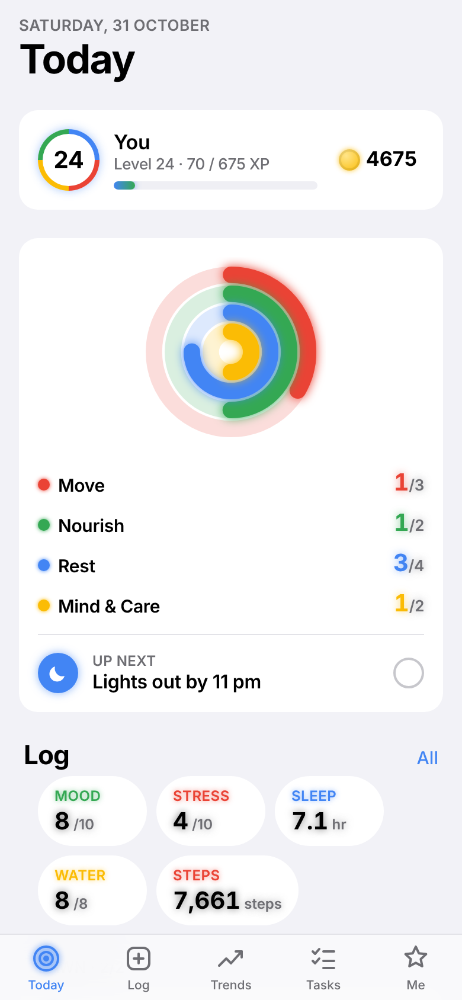 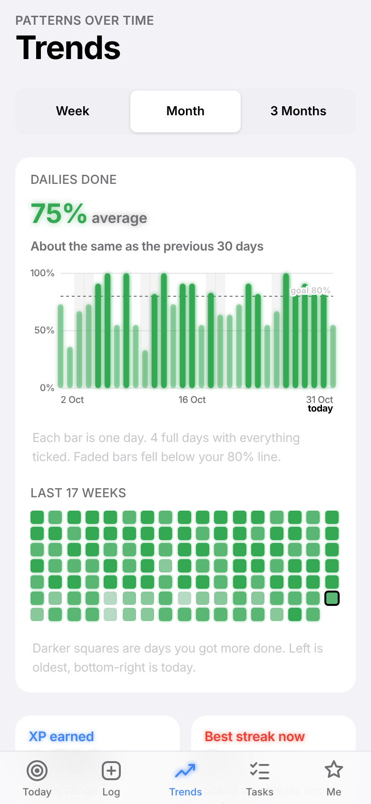 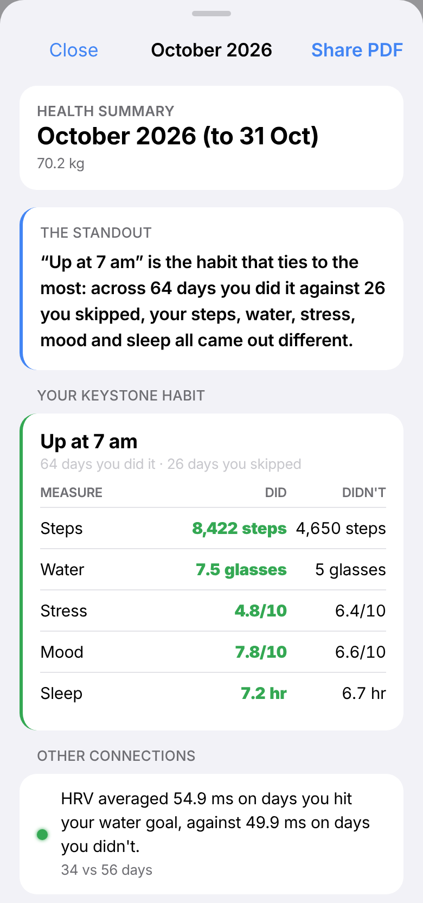

---

## What makes it different

Every month, Healthbook does something no other habit app does: it looks across everything you've logged and finds **your keystone habit** — the one that lines up with the most improvement everywhere else.

> **"Up at 7 am" is the habit that ties to the most.** Across 64 days you did it against 26 you skipped, your steps, water, stress, mood and sleep all came out different.
>
> | Measure | Did | Didn't |
> |---|---|---|
> | Steps | **8,422** | 4,650 |
> | Water | **7.5 glasses** | 5 glasses |
> | Stress | **4.8/10** | 6.4/10 |
> | Mood | **7.8/10** | 6.6/10 |
> | Sleep | **7.2 hr** | 6.7 hr |

That's the whole point. Not "you missed a day" — but *this is the thing to protect when life gets busy.*

## Why you'd use it

|  | |
|---|---|
| **It's yours to shape** | Every habit, task, reward and tracker is one you wrote. Nothing is preset and nothing is locked. |
| **It never punishes you** | You earn XP and levels for what you do. Miss a week and you lose nothing — the streak just starts again. |
| **It compares you to you** | "7 hours is normal" is useless. "That's 50 minutes less than your usual" is the thing worth knowing. |
| **It finds real connections** | Drawn from 90 days, not 30, with a statistical bar to clear — so you get patterns, not coincidences. |
| **It gives your doctor a page** | A clean monthly PDF of your own numbers. Built by arithmetic on your phone. No AI anywhere near it. |
| **It works offline** | No account needed. Everything runs on your phone. An account only adds backup and a second device. |
| **It listens to your body** | After a bad night by your own standards, it offers an easy day: only Easy dailies count, and streaks on the rest pause instead of breaking. |
| **It lets you test things** | Try one change for 7, 14 or 21 days and get an honest before-and-during answer on the numbers you care about. Then keep it or drop it. |
| **It's quiet** | Reminders skip days you've already finished the task. Nothing nags you about something you did. |

## Install

1. Download **Healthbook.apk** from [Releases](../../releases/latest)
2. Open it on your Android phone and allow installs from this source
3. Set up takes about a minute

Android 8.0 or newer. Not on the Play Store — install it directly.

**Updating from 1.0.10 or earlier:** the app's signing key was replaced, so this one update won't install over the old version. Export a backup in Me (or sign in so it syncs), uninstall, install the new version, then import or sign in. Every update after that installs normally.

---

## A tour

### Today — what's in front of you

Four rings for the four parts of your life you're working on, what's up next, and your quick log. Tap to tick. That's it.

 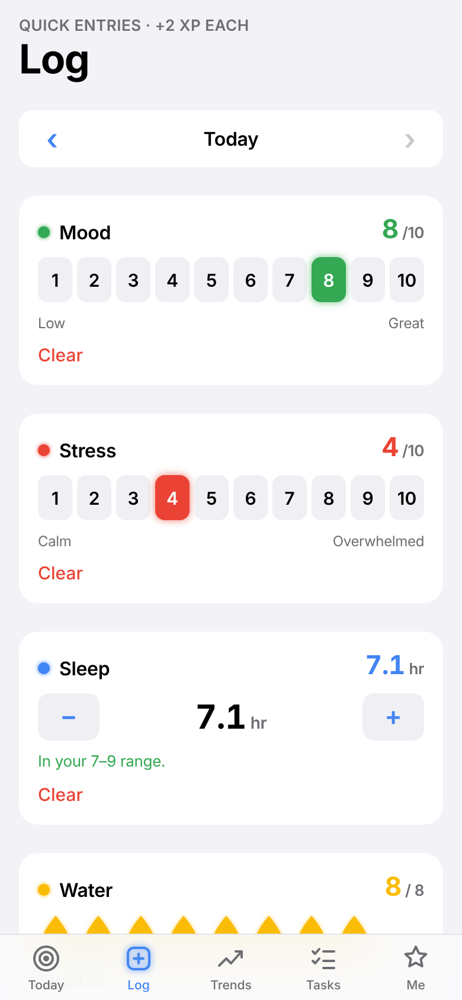 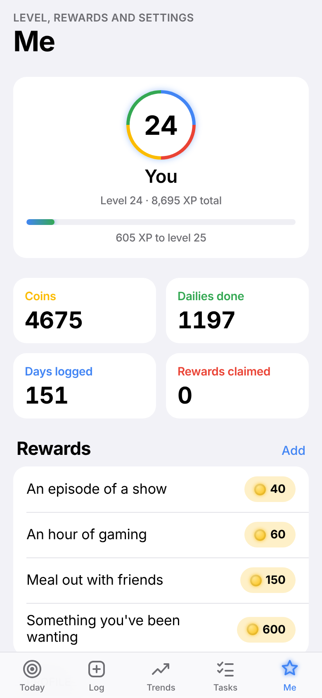

### Trends — charts that explain themselves

Weekends are shaded. Your goal line is labelled. Faded bars are days you missed. Every chart has a sentence under it telling you what it shows, so you never have to decode a graph.

 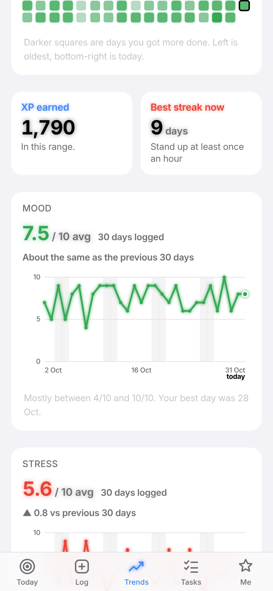

### Editing — simple enough that you'll actually do it

One question at a time, in plain words. "What is it?" "Which days?" "Remind me." Tap a suggestion if you can't think of one. Everything clever is behind **More options** — including making a habit tick itself when your water hits 8.

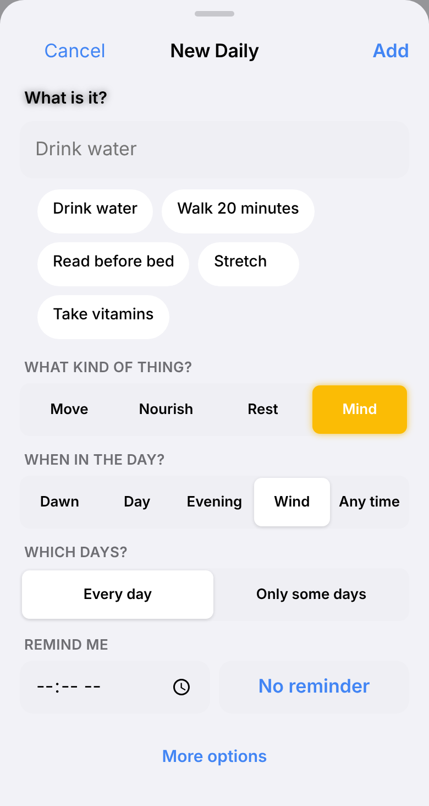 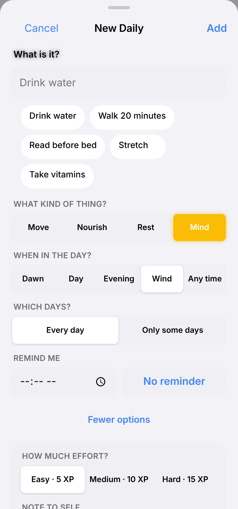 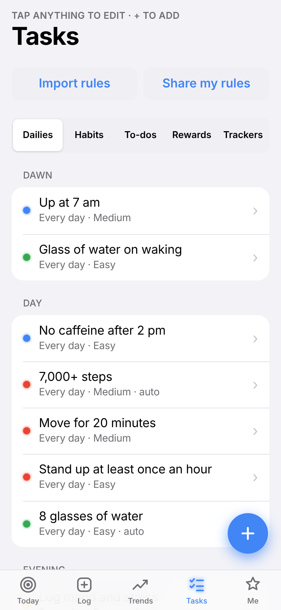

### Easy days — for when your body says no

If last night's sleep, HRV or resting heart rate is clearly off *your own* last 30 days, Today asks if you want an easy day. Say yes and only your Easy dailies are due; Medium and Hard ones pause, and their streaks wait instead of breaking. Rough for reasons a ring can't see? There's a quiet "make it an easy day" link at the bottom of Today too.

### Experiments — find out if it actually works

"Does cutting caffeine after 2 pm help my sleep?" Start an experiment, pick what it should change, and live with it for 7, 14 or 21 days. At the end you get the days during next to the same number of days before, with each number called plainly: clearly better, slightly different, no real change, or not enough readings. If you tie it to a daily, it also tells you how often you actually stuck to it. Keep it and it becomes a daily in one tap.

### Your monthly summary

Arrives on the 1st. Leads with the single most notable thing, then your keystone habit, then anything a doctor should see, then what's going well. Share it as a PDF.

 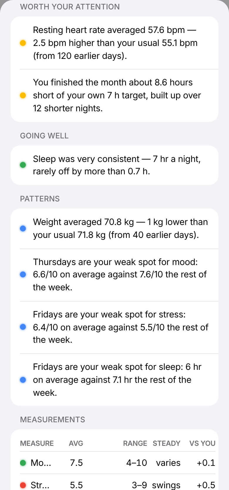

### Light, dark and AMOLED

Follows your phone, or pick one. AMOLED goes true black with a little glow on the colour.

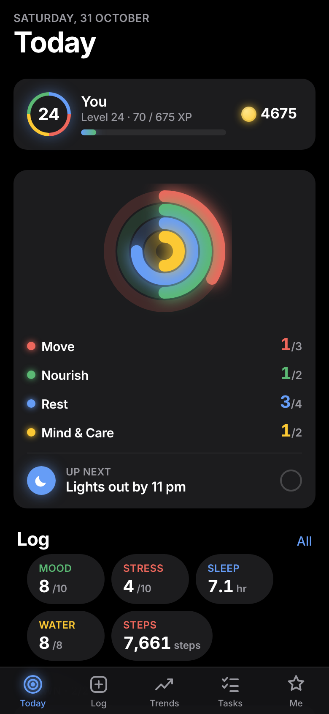 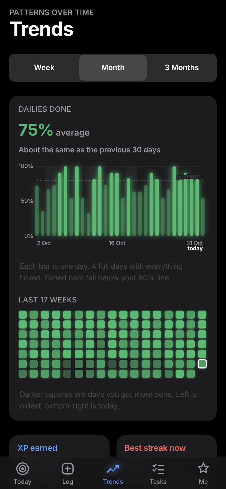 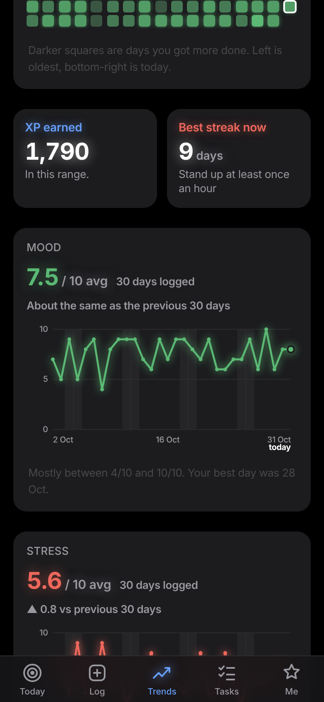

---

## What it tracks

Steps, sleep, resting heart rate, HRV and weight sync automatically from Samsung Health, Fitbit, Garmin, Google Fit, and most rings and watches. Water, mood, stress and anything else you invent, you log yourself in a couple of taps. Anything you type by hand is never overwritten by a sync.

## Share your setup with a friend

Your whole plan exports as plain text you can edit in any notes app and send to anyone. They import it and start from your setup instead of a blank screen.

## Honest about what it isn't

Healthbook describes what happened together in your own data. It does not diagnose anything, and it cannot tell you that one thing caused another — only that they showed up together. Consumer rings and watches aren't medical devices. Read the monthly summary alongside a doctor, not instead of one.

---

© Madhav Mathur. All rights reserved. Not open source — see LICENSE.

